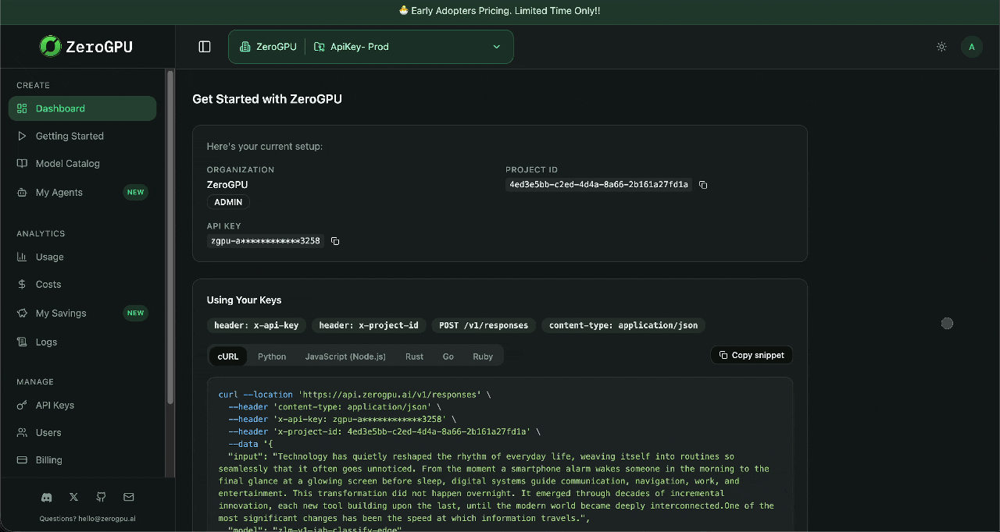

<p align="center">
  <a href="https://www.zerogpu.ai">
    
  </a>
</p>

<h1 align="center">ZeroGPU</h1>

<p align="center">
  <strong>Turn idle compute across your app's device footprint into recurring revenue.</strong><br/>
  ZeroGPU runs AI inference on idle devices at the edge, and the Edge Providers who connect them earn from every request they serve.
</p>

<p align="center">
  <a href="https://edge.zerogpu.ai/auth/sign-up">
    
  </a>
  &nbsp;
  <a href="https://docs.zerogpu.ai/docs/edge-providers/index">
    
  </a>
  &nbsp;
  <a href="https://www.zerogpu.ai">
    
  </a>
</p>

---

## Earn with your devices

1. **Register.** Sign up in the [Edge Operator Portal](https://edge.zerogpu.ai/auth/sign-up) and add your app or GPU fleet. Once it's approved, you get its SDK key.
2. **Connect.** Add a ZeroGPU SDK to the app you already ship, or install ZeroGPU Edge on the machines you manage.
3. **Serve.** While your devices are idle, they serve AI inference requests from ZeroGPU customers. There are no servers for you to run.
4. **Get paid.** You earn a revenue share of every request your devices serve. Track devices, requests and earnings in the portal, and withdraw when you're ready.

## Edge provider SDKs and packages

| Platform | Install | Quickstart | Docs | GitHub |
| --- | --- | --- | --- | --- |
| **Android** | Maven Central `ai.zerogpu:android-sdk` | [Get started](https://github.com/zerogpu/edge-android#get-started) | [Android](https://docs.zerogpu.ai/docs/edge-providers/sdk/android) | [edge-android](https://github.com/zerogpu/edge-android) · [Releases](https://github.com/zerogpu/edge-android/releases) |
| **Chrome** | npm `@zerogpu/browser-extension-sdk` | [Get started](https://github.com/zerogpu/edge-chrome#get-started) | [Chrome / Web](https://docs.zerogpu.ai/docs/edge-providers/sdk/web) | [edge-chrome](https://github.com/zerogpu/edge-chrome) · [Releases](https://github.com/zerogpu/edge-chrome/releases) |
| **Telegram** | One `<script>` tag | [Get started](https://github.com/zerogpu/edge-telegram#get-started) | [Telegram Mini Apps](https://docs.zerogpu.ai/docs/edge-providers/sdk/telegram) | [edge-telegram](https://github.com/zerogpu/edge-telegram) · [Releases](https://github.com/zerogpu/edge-telegram/releases) |
| **Windows** | [ZeroGPU Edge for Windows](https://apps.zerogpu.ai/edge?os=windows) (`.exe`, `.msi`) | [Install](https://docs.zerogpu.ai/docs/edge-providers/fleet/windows) | [GPU Fleet](https://docs.zerogpu.ai/docs/edge-providers/fleet) | — |
| **macOS** | [ZeroGPU Edge for macOS](https://apps.zerogpu.ai/edge?os=macos) (`.dmg`, `.pkg`) · npm `@zerogpu/worker` for Electron apps | [Install](https://docs.zerogpu.ai/docs/edge-providers/fleet/macos) | [GPU Fleet](https://docs.zerogpu.ai/docs/edge-providers/fleet) · [macOS apps](https://docs.zerogpu.ai/docs/edge-providers/sdk/macos) | — |
| **Linux** | [ZeroGPU Edge for Linux](https://apps.zerogpu.ai/edge?os=linux) (`.deb`, `.rpm`) | [Install](https://docs.zerogpu.ai/docs/edge-providers/fleet/linux) | [GPU Fleet](https://docs.zerogpu.ai/docs/edge-providers/fleet) | — |

New here? Start with the [Edge Provider guide](https://docs.zerogpu.ai/docs/edge-providers/get-started), then [verify your devices and earnings](https://docs.zerogpu.ai/docs/edge-providers/verify).

---

## Building with AI? Use the ZeroGPU API

ZeroGPU serves small and nano language models across that edge network through one OpenAI-compatible API, so it's faster and cheaper than centralized GPUs for classification, extraction, PII redaction, moderation, and summarization.

```bash
curl https://api.zerogpu.ai/v1/responses \
  -H "x-api-key: $ZEROGPU_API_KEY" \
  -H "Content-Type: application/json" \
  -d '{"model": "llama-3.1-8b-instruct-fast", "input": "Summarize: ..."}'
```

<p align="center">
  
</p>

| Repository | What you'll find there |
| --- | --- |
| [**zerogpu-api-sdk**](https://github.com/zerogpu/zerogpu-api-sdk) | Official API clients: [npm `zerogpu-api`](https://www.npmjs.com/package/zerogpu-api), [PyPI `zerogpu-api`](https://pypi.org/project/zerogpu-api/), and more |
| [**zerogpu-router**](https://github.com/zerogpu/zerogpu-router) | Claude Code and OpenClaw plugins that offload cheap agent tasks to nano models |
| [**langchain-zerogpu**](https://github.com/zerogpu/langchain-zerogpu) | LangChain tools for ZeroGPU models |
| [**cli**](https://github.com/zerogpu/cli) | The `zerogpu` terminal CLI |
| [**docs**](https://github.com/zerogpu/docs) | Source for [docs.zerogpu.ai](https://docs.zerogpu.ai) |

Get an API key at [platform.zerogpu.ai](https://platform.zerogpu.ai). API reference: [Responses](https://docs.zerogpu.ai/api-reference/responses) · [Chat completions](https://docs.zerogpu.ai/api-reference/chat-completions).
